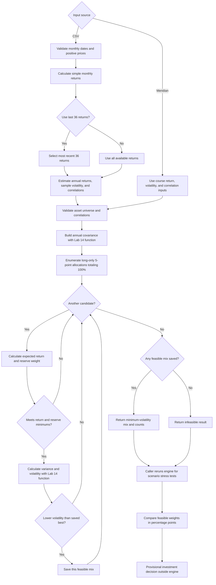

# FIN 43900 — Lab 15: Portfolio Stability Decision

## 1. Question and objective

**Which mix carries the least risk while meeting the mandate, and does the answer survive a one-point change in one estimate?** This implementation follows the [official Lab 15 instructions](https://github.com/CinderZhang/FIN43900-Fall2026/blob/main/lessons/week-09/lab-15-portfolio-stability.md) and preserves the [Lab 14 engine](https://github.com/CinderZhang/FIN43900-Fall2026/blob/main/lessons/week-09/lab-14-portfolio-baselines.md) in a new `lab15/portfolio.py` copy. The professor's literal root-file editing instruction is adapted to preserve previous academic work; the app imports the new copy.

## 2. Meridian training validation

Course-authored assumptions, not market estimates. Asset order: Treasury bills / Treasury 10-year note / investment-grade bond fund / global equity index fund. Objective 6.5%; Treasury reserve minimum 3%.

| Case | Weights (%) | Return | Volatility | Largest change from original |
|---|---|---:|---:|---:|
| Original | 0 / 20 / 25 / 55 | 6.51% | 9.44% | — |
| Equity estimate 8% → 7% | 0 / 10 / 10 / 80 | 6.53% | 12.94% | 25 points |
| IG/equity correlations 0.25 → 0.50 symmetrically | 0 / 40 / 0 / 60 | 6.52% | 9.73% | 25 points |

All are calculated by `optimize_portfolio`, then checked against the instructor's displayed targets. Both correlation cells were temporarily edited in **`lab15/portfolio.py`**, and Streamlit AppTest showed 0/40/0/60. The file was restored in `finally`; a fresh AppTest returned 0/20/25/55. This verifies a real Streamlit rerun from source, **not a manual browser refresh**. The committed correlations are 0.25.

## 3. Dated Project 2 mandate amendment — 2026-10-22

This exercise changes the personal client from the five-year home purchase described in the unchanged Lab 13/14 files to a young investor accumulating wealth over **15 years**, with flexibility to stay invested longer. The investor can accept meaningful market volatility. Minimize estimated annualized volatility subject to a **provisional student-selected 6.0% annual nominal expected-return floor**. This is a planning assumption, not an independent forecast or guarantee. Fully invested, long-only, no leverage, shorts, or derivatives; only VTI, VXUS, XLE, IWM, IAU; 5-percentage-point grid. **Personal reserve hard constraint: none; minimum 0%.** No sector or asset caps were added. The old reports are not retroactively changed.

## 4. Five-ETF universe

| Ticker | Fund and role | Issuer source |
|---|---|---|
| VTI | Vanguard Total Stock Market ETF; diversified U.S. equity core | [Vanguard ETF options](https://investor.vanguard.com/investment-products/etfs/etf-investment-options) |
| VXUS | Vanguard Total International Stock ETF; non-U.S. equity diversification | [Vanguard international ETFs](https://investor.vanguard.com/investor-resources-education/etfs/international-etf) |
| XLE | Energy Select Sector SPDR Fund; concentrated U.S. energy tilt | [State Street XLE](https://www.ssga.com/us/en/individual/etfs/state-street-energy-select-sector-spdr-etf-xle) |
| IWM | iShares Russell 2000 ETF; U.S. small-cap tilt | [iShares IWM](https://www.ishares.com/us/products/239710/ishares-russell-2000-etf) |
| IAU | iShares Gold Trust; gold-price exposure | [iShares IAU](https://www.ishares.com/us/products/239561/iau-ishares-gold-trust-fund) |

VTI already owns small-cap and energy businesses, so IWM and XLE deliberately overweight existing exposures. Five funds do not imply five independent risks. Gold has diversified this sample but cannot guarantee protection during equity losses; IAU is a gold trust, not an operating-company equity fund.

## 5. Historical prices and sources

**Retrieved 2026-10-22.** `download_prices.py` called `yfinance.Ticker(ticker).history(start="2021-10-01", end="2026-10-01", interval="1d", auto_adjust=False, actions=False)` for each ticker and required the explicit `Adj Close` column. It selected each completed calendar month's final available trading-day adjusted close, labeled the row at calendar month-end, and wrote 12 significant digits. It did not re-adjust the series. Yahoo sources: [VTI](https://finance.yahoo.com/quote/VTI/history/), [VXUS](https://finance.yahoo.com/quote/VXUS/history/), [XLE](https://finance.yahoo.com/quote/XLE/history/), [IWM](https://finance.yahoo.com/quote/IWM/history/), [IAU](https://finance.yahoo.com/quote/IAU/history/). All five were obtained consistently from Yahoo; no fallback was used. [Yahoo's adjusted-close explanation](https://help.yahoo.com/kb/finance/adjusted-close-sln28256.html) describes split/dividend adjustment.

The script automatically attempts [Digrin VTI](https://www.digrin.com/stocks/detail/VTI/price), [VXUS](https://www.digrin.com/stocks/detail/VXUS/price), [XLE](https://www.digrin.com/stocks/detail/XLE/price), [IWM](https://www.digrin.com/stocks/detail/IWM/price), and [IAU](https://www.digrin.com/stocks/detail/IAU/price) **for all five tickers** if Yahoo fails or returns an incomplete window. Its parser and 60-month coverage were checked on 2026-10-22; the current committed CSV did **not** use this fallback. Digrin labels its series “Adjusted price” but publishes only two decimals and does not document enough to assert equivalence with Yahoo Adj Close. A future Digrin fallback output must be labeled as such in this report and not silently compared as the same price convention.

Validation: exactly `Date,VTI,VXUS,XLE,IWM,IAU`; **60** monthly rows, October 2021–September 2026; five aligned USD-listed ticker series; chronological, unique, consecutive months; positive finite values and no missing cells. October 2026 is excluded. The largest absolute observed monthly simple return is **24.97% in XLE**; XLE is a volatile energy-sector fund, so this was flagged for review rather than silently deleted or winsorized. The CSV reproduces the downloaded Yahoo values at stored precision, but market vendors can later revise adjusted histories. The script's output is a static snapshot and Yahoo access may change; independently compare a future download before replacing it. Calendar month-end labels are not themselves trading dates.

## 6. Estimation method

For aligned month-end prices, simple monthly return is `P_t/P_(t-1)-1`. Annual expected-return **estimate** is the arithmetic mean monthly simple return × 12. Annualized sample volatility is monthly standard deviation with `ddof=1` × √12. Pearson correlations use aligned returns; annual covariance is correlation × annual volatility × annual volatility, passed into the existing Lab 14 risk engine. The full 60 prices yield **59 returns** (November 2021–September 2026). The recent window uses the **last 36 returns**, which require 37 prices (October 2023–September 2026). Annual arithmetic estimates are not compound growth forecasts.

| ETF | Full return estimate | Full vol estimate | Last-36 return estimate | Last-36 vol estimate |
|---|---:|---:|---:|---:|
| VTI | 12.00% | 15.87% | 21.11% | 12.86% |
| VXUS | 9.70% | 15.27% | 19.19% | 11.97% |
| XLE | 22.43% | 25.97% | 15.52% | 20.48% |
| IWM | 7.44% | 21.02% | 18.14% | 19.60% |
| IAU | 18.54% | 17.35% | 28.81% | 18.95% |

Pearson correlation matrices, asset order VTI/VXUS/XLE/IWM/IAU, rounded to three decimals:

| Full | VTI | VXUS | XLE | IWM | IAU |
|---|---:|---:|---:|---:|---:|
| VTI | 1.000 | .802 | .274 | .883 | .163 |
| VXUS | .802 | 1.000 | .271 | .722 | .478 |
| XLE | .274 | .271 | 1.000 | .328 | .099 |
| IWM | .883 | .722 | .328 | 1.000 | .121 |
| IAU | .163 | .478 | .099 | .121 | 1.000 |

| Last 36 | VTI | VXUS | XLE | IWM | IAU |
|---|---:|---:|---:|---:|---:|
| VTI | 1.000 | .716 | .017 | .849 | -.015 |
| VXUS | .716 | 1.000 | .057 | .698 | .408 |
| XLE | .017 | .057 | 1.000 | .188 | .216 |
| IWM | .849 | .698 | .188 | 1.000 | .024 |
| IAU | -.015 | .408 | .216 | .024 | 1.000 |

## 7. Optimizer

`allocation_units` recursively enumerates nonnegative integer units totaling 20; five assets produce **10,626** candidates. `optimize_portfolio` converts them to weights, uses the Lab 14 return and covariance/variance functions, filters by required expected return and reserve weight, and keeps the lowest-volatility feasible mix. First enumerated mix wins a numerical tie. It reports feasible and candidate counts; if none qualify, it returns `feasible=False`, and the app displays exactly **“no mix meets the objective.”** The search enforces only the stated return, reserve, fully-invested, long-only, grid and universe rules; it does not model turnover, taxes, drawdowns, liquidity, or concentration caps.

## 8. Engine flowchart

The loop and infeasible branch follow `optimize_portfolio` directly. The app or analysis code initiates scenario reruns; `largest_weight_change` compares two feasible results. The investment decision is a human judgment outside `portfolio.py`.

## 9–11. Benchmark and optimized results

All weights follow VTI/VXUS/XLE/IWM/IAU. The benchmark **45/25/10/10/10** is illustrative, not optimized: estimated return **12.67%**, volatility **13.88%**. The full-history optimum is **50/0/10/0/40**, return **15.66%**, volatility **12.27%**, feasible with **10,626/10,626** candidate mixes clearing the 6% floor. Relative to the benchmark, its largest weight difference is **30 points** in IAU; it removes VXUS and IWM and adds 30 points to gold. This is a mathematical historical minimum, not a reason by itself to own 40% gold.

The last-36-return optimum is **45/20/20/0/15**, return **20.76%**, volatility **9.79%**, feasible with **10,626/10,626** qualifying mixes. The largest individual move from full history is **25 points in IAU** (40% → 15%). Recent-window estimates differ substantially from the full period, so the lower reported volatility cannot be read as a promise of lower future risk.

## 12. One-point expected-return sensitivity

All other full-history returns, volatilities and correlations held fixed; return objective stays 6%.

| Case | Weights (%) | Return estimate | Volatility estimate | Max weight move |
|---|---|---:|---:|---:|
| Original | 50/0/10/0/40 | 15.66% | 12.27% | — |
| VTI expected return −1 point | 50/0/10/0/40 | 15.16% | 12.27% | 0 points |
| XLE expected return −1 point | 50/0/10/0/40 | 15.56% | 12.27% | 0 points |
| IAU expected return −1 point | 50/0/10/0/40 | 15.26% | 12.27% | 0 points |
| Deliberately infeasible 100% required return | No feasible mix | — | — | unavailable |

Each one-point shock leaves every candidate above 6%, so expected returns change but the minimum-variance selection does not. That is a consequence of a **slack return constraint**, not evidence that return estimates are generally reliable. When a return boundary binds, a small input error can move feasible grid choices abruptly; Meridian's 25-point equity shock demonstrates this mechanism. The ETF window change moves 25 points because both risk and return estimates change.

## 13. Higher return requirement

Changing the **client objective**, with fund estimates and covariance fixed, from 6% to 7% leaves the full-history optimum at **50/0/10/0/40**, return **15.66%**, volatility **12.27%**, max weight movement **0 points**, and **10,626** feasible candidates in both cases. The 7% target is also slack. Raising a target above the low-risk mix's estimated return would force a riskier feasible allocation or infeasibility; it is not established that VTI or IWM would increase here.

Partner's conceptual challenge supplied by the student: “What if the client wants a higher return because they're young and willing to take on more risk?” Proposed response for review: “If the client wanted a higher expected return, I could raise the return objective and rerun the optimizer. Here, moving from 6% to 7% does not change the allocation because both thresholds are below the minimum-volatility mix's estimated return; I would still assess possible losses and sensitivity before recommending it.” This conceptual challenge does **not** document an actual partner app interaction.

## 14. Partner app attack — student verification required

- Partner and date: **[student to complete]**
- Actual distrusted estimate and before/after value changed in the app: **[student to complete]**
- Observed allocation, return, volatility, and largest move: **[student to complete]**
- Two-sentence student response: **[student to complete]**

## 15. Explain the code — student oral exercise

`optimize_portfolio` validates the 3–6 asset universe, estimates and correlation matrix; builds annual covariance through the copied Lab 14 function; loops over integer-unit allocations; computes each candidate's expected return and reserve weight; rejects any below the hard constraints; computes volatility through `portfolio_variance_and_volatility`; then keeps the minimum with deterministic ties. **Student's own line-by-line explanation, partner's actual question, and answer: [student to complete after oral exercise].**

## 16. Estimation risk — preparation, not oral participation

Estimation risk is the possibility that sample means, volatilities, and correlations differ from future outcomes. Optimizers can amplify small return errors when a hard return boundary makes nearby allocations switch feasibility, or when estimated covariances make two portfolios nearly tied. In these ETF calculations, three isolated one-point return reductions caused **0-point** weight shifts because the 6% floor is slack; changing the sample window caused a **25-point** IAU shift. The student still must explain this to a partner in their own words.

## 17–18. Provisional investment decision and reflection

**PILOT, subject to student approval.** The full-history optimum has 40% IAU and no VXUS or IWM; the 36-month optimum cuts IAU to 15% and adds VXUS and XLE. VTI and IWM share U.S. equity risk, XLE is a concentrated cyclical sector, and gold can be volatile and fail to hedge an equity drawdown. The sample's high annualized arithmetic returns make the 6% floor irrelevant, so the optimizer is mostly choosing historical minimum variance. A suitable long-term holding decision needs forward-looking return ranges, drawdown scenarios, inflation and spending needs, costs/taxes, and out-of-sample checks. I would reconsider adoption only after these checks show a robust mix under plausible assumptions and the student confirms comfort with concentration and losses. The allocation moved because sample-window covariance estimates changed, especially the relationship among IAU, XLE, and equities. **Final student decision and personal reflection: [student to complete].**

## 19. AI use and limits

AI assisted coding, tests, data processing, and draft analysis. This is a learning demonstration, not investment advice. Historical arithmetic means are estimates and are especially vulnerable to the chosen 2021–2026 sample; the 15-year horizon is far longer than the 59 observed returns. Yahoo's adjusted series may be revised. The model excludes real-world suitability, drawdowns, funding needs, implementation friction, tax, and other mandate rules. No partner participation, paper diagram, quiz, or personal reflection is claimed by the code author.

## 20. Validation record

Commands executed from the repository root: `python3 portfolio.py`; `python3 lab15/portfolio.py`; `python3 -m unittest test_portfolio lab15.test_lab15 -v` (**18 tests, OK: 6 original + 12 Lab 15**); `python3 -m compileall -q lab15` (passed); `python3 -m streamlit run lab15/app.py --server.headless true --server.port 8502` (server started); and an HTTP health check returned `ok`. Streamlit AppTest exercised Meridian, a changed expected-return control, infeasibility, mode switch, last-36 toggle, and temporary source correlation edit/restoration. The source-edit test used `try/finally`; a manual browser refresh and the file-upload widget were not tested through a browser. The CSV estimator was tested with file-like uploads. Browser automation was unavailable in this environment.

| Audit item | Status | Evidence or remaining work |
|---|---|---|
| A. Existing tracked files unchanged | PASS | Git diff limited to new `lab15/` files |
| B. Copied CLI output | PASS | Byte-for-byte subprocess comparison |
| C. Meridian three cases | PASS | Known-answer assertions |
| D–F. Correct app engine, controls, source edit | PARTIAL | Streamlit AppTest and server health passed; manual browser refresh/upload-widget check remains |
| G–K. Sourced prices and ETF scenarios | PASS | Yahoo 60-month panel; 59/36-return calculations |
| L–M. Mermaid and computed writing | PASS | Flowchart and values above |
| N. Participation honesty | PASS | Student fields remain open |
| O. Hosting instructions | PASS | Local dependency and Cloud entrypoint documented |
| P. Published GitHub links | PASS after push | Links below require successful push |

## 21. GitHub submission and student checklist

New files: [engine](https://github.com/cmainville/FIN43900/blob/main/lab15/portfolio.py), [app](https://github.com/cmainville/FIN43900/blob/main/lab15/app.py), [downloader](https://github.com/cmainville/FIN43900/blob/main/lab15/download_prices.py), [price CSV](https://github.com/cmainville/FIN43900/blob/main/lab15/prices_growth.csv), [tests](https://github.com/cmainville/FIN43900/blob/main/lab15/test_lab15.py), [dependencies](https://github.com/cmainville/FIN43900/blob/main/lab15/requirements.txt), [README](https://github.com/cmainville/FIN43900/blob/main/lab15/README.md), [report](https://github.com/cmainville/FIN43900/blob/main/lab15/lab15-notes.md), and [package initializer](https://github.com/cmainville/FIN43900/blob/main/lab15/__init__.py).

**TODO — student action:** Rerun `portfolio.py`; present the universe and mandate to a partner; draw the engine on paper before viewing the Mermaid chart and compare them; explain the optimizer line by line and answer the partner's actual question; have the partner change an estimate in the app and record the result and two-sentence response; explain estimation risk orally; finalize adopt/pilot/reject and personal reflection; open and submit the Brightspace Lab 15 quiz; review ALFRED preparation before Tuesday. None is marked complete here.
